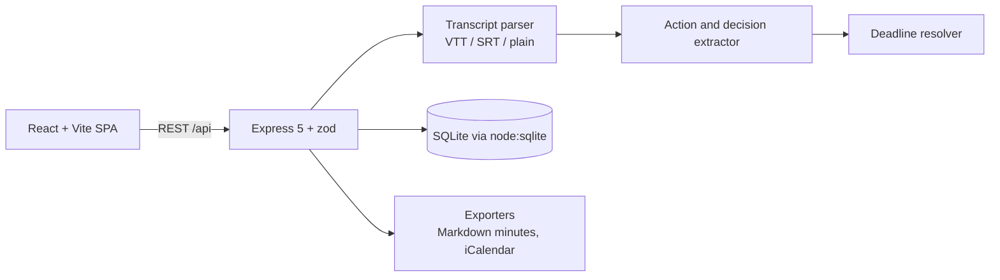

# Meeting Action Tracker

Turn meeting transcripts into a tracked list of **who does what by when**. Drop in a Teams, Zoom or Google Meet transcript and the app extracts action items with owners, due dates and priorities, plus the decisions that were made. Every item links back to the exact line in the transcript where it was said, and you can manage the items on a board and export minutes or calendar reminders.

Runs entirely locally. No paid APIs, no data leaves your machine.

## Problem

Action items get lost after meetings. Someone says "I'll send the deck by Friday" or "Rahul, can you look into the crash?", and a week later nobody remembers who agreed to what. Manually writing minutes is tedious. Generic LLM summaries are expensive, can't be audited, and often invent owners or dates.

## Solution

A deterministic NLP pipeline tuned to how people actually commit to work in meetings:

| Pattern | Example | Owner resolved from |
|---|---|---|
| Self-commitment | "I'll send the revised deck by Friday." | the speaker |
| Named request | "Rahul, can you fix the timeout bug ASAP?" | the person addressed |
| Unnamed request | "Could you share the credentials?" → "Sure." | whoever says yes in the next turn |
| Assignment | "Anita will send the API contract." | the named person |
| Explicit marker | "Action item: Joe to draft the incident report by 20/11" | the named person or `@mention` |
| Team task | "We need to update the release checklist." | unassigned (flagged) |
| Decision | "We've decided to go with Razorpay." | recorded as a decision |

On top of the patterns, the pipeline:

- **Rewrites task text.** It removes the lead-in ("I'll", "can you"), filler words and the deadline phrase, and turns first-person words into the requester's name: "review my PR" said by Anita becomes "Review Anita's PR".
- **Resolves deadlines** relative to the meeting date: today, EOD, tomorrow, by Friday, next Friday, end of week/month, in 3 days, Nov 25, 5th December, 2026-12-01, and Indian-style 28/11. Dates in the past roll over to next year.
- **Sets priority** from the wording ("ASAP", "blocker" mean high; "no rush", "when you get a chance" mean low) or from a deadline within a day.
- **Splits compound sentences** ("Rahul will X and Anita will Y") and **merges duplicates**, so a wrap-up restatement folds into the original, more detailed item.
- **Scores confidence** per item, so hedged commitments ("I'll maybe try to…") rank lower.
- **Skips non-tasks** such as "I'll be honest…", "Can you hear me?" and "I'll see you tomorrow".

## Features

- Transcript import: WebVTT (including `<v Speaker>` voice tags), SRT, and plain `Speaker: text` with optional `[mm:ss]` timestamps. Split cues from the same speaker are merged.
- Meeting view: action items, decisions, and the transcript with source lines highlighted. "Show in transcript" scrolls to where each item was said.
- Action board: Open / In progress / Done columns, filtered by owner or overdue only, with inline editing of owner and due date.
- People view: open, in-progress, done and overdue counts per person.
- Exports: Markdown minutes grouped by owner, and an iCalendar (`.ics`) feed of open items with due dates (RFC 5545 escaping and line folding).
- Validation everywhere (zod), consistent JSON errors, cascade deletes, indexed queries.

## Architecture



### Database design

```
meetings(id PK, title, meeting_date, participants JSON, decisions JSON, utterances JSON, created_at)
actions(id PK, meeting_id FK→meetings ON DELETE CASCADE, task, owner, due_date, due_phrase,
        priority CHECK(high|medium|low), status CHECK(open|in_progress|done),
        confidence, kind, source_index, quote, created_at, updated_at)
indexes: actions(owner NOCASE), actions(status, due_date), actions(meeting_id)
```

SQLite runs on Node's built-in `node:sqlite`, so there's no native build step. The store sits behind a small class, so switching to PostgreSQL only touches `server/src/db.ts`.

## Tech stack

TypeScript everywhere. **Backend:** Node.js 22.13+, Express 5, zod, `node:sqlite`. **Frontend:** React 18, Vite. **Testing:** Vitest and Supertest. **Ops:** a multi-stage Docker image with a healthcheck, and GitHub Actions running typecheck, tests and build on Node 22 and 24, plus a Docker smoke test.

## Getting started

```bash
npm install
npm run build          # builds web/ then server/
npm start              # http://localhost:3000
```

Development with hot reload, using two terminals:

```bash
npm run dev -w server  # API on :3000
npm run dev -w web     # UI on :5173, proxies /api to :3000
```

Then add a meeting and upload `samples/sprint-planning.vtt`, or paste a transcript.

Docker:

```bash
docker build -t meeting-action-tracker .
docker run -p 3000:3000 -v mat-data:/data meeting-action-tracker
```

| Env var | Default | Purpose |
|---|---|---|
| `PORT` | `3000` | HTTP port |
| `DB_PATH` | `data/meetings.db` | SQLite file |
| `STATIC_DIR` | `web/dist` | Built frontend to serve |

## Example

Input (excerpt of `samples/sprint-planning.vtt`, meeting date 2026-11-16, a Monday):

```
Priya Sharma: That's a blocker for the release. Rahul, can you fix the checkout timeout bug by tomorrow?
Rahul Verma:  Yes, on it.
Anita Desai:  On the API side, I'll send the updated API contract to the mobile team by Friday.
Rahul Verma:  Could you share the Razorpay sandbox credentials with me?
Anita Desai:  Sure.
Anita Desai:  No rush, but Rahul, could you review my pagination PR when you get a chance?
```

Extracted:

| Owner | Task | Due | Priority |
|---|---|---|---|
| Rahul Verma | Fix the checkout timeout bug | 2026-11-17 | high |
| Anita Desai | Send the updated API contract to the mobile team | 2026-11-20 | medium |
| Anita Desai | Share the Razorpay sandbox credentials with Rahul | | medium |
| Rahul Verma | Review Anita's pagination PR | | low |

## API

| Method | Path | Description |
|---|---|---|
| GET | `/api/health` | Liveness |
| POST | `/api/meetings` | `{title, meetingDate: YYYY-MM-DD, transcript, format?}`. Parses, extracts and stores; returns `{meeting, actions}` |
| GET | `/api/meetings` | Meetings with action and open counts |
| GET | `/api/meetings/:id` | Meeting with transcript, decisions and actions |
| GET | `/api/meetings/:id/minutes.md` | Markdown minutes |
| DELETE | `/api/meetings/:id` | Delete meeting and its actions |
| GET | `/api/actions?owner=&status=&meetingId=&overdue=true&unassigned=true` | Filtered action list (open first, then by due date and priority) |
| PATCH | `/api/actions/:id` | `{status?, owner?, dueDate?, priority?, task?}` |
| GET | `/api/actions.ics` | iCalendar feed of open, dated actions |
| GET | `/api/owners` | Workload per owner, including overdue counts |

Errors return `{error}` with `400` (malformed JSON or bad id), `404`, `413` (body over 2 MB) or `422` (validation, with per-field `details`).

## Tests

```bash
npm test
```

42 tests cover:
- 17 deadline phrasings, plus impossible dates
- the three transcript formats
- every extraction pattern, including the negative cases (questions, pleasantries, hedges)
- clause splitting, duplicate merging and pronoun rewriting
- every API endpoint and error path
- cascade deletes and the overdue logic
- the Markdown and iCalendar exports, including the 75-octet line folding

## Limitations

Rule-based extraction is precise on common phrasing but can miss unusual wording, for example "It'd be great if somebody owned the migration." Confidence scores and the transcript links make it quick to review and correct items on the board.

## Future enhancements

- Local speech-to-text (Whisper) so audio recordings can be uploaded directly
- Optional local-LLM pass (Ollama) for phrasing the rules miss, validated against the transcript
- Slack and email reminders for items due soon
- PostgreSQL adapter and multi-user auth
- Drag-and-drop on the board

## License

MIT
